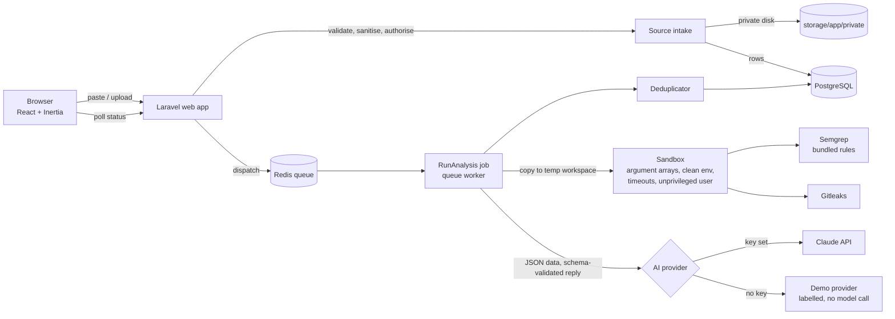

# CodeSentinel AI

Paste or upload source code, and CodeSentinel scans it with Semgrep and Gitleaks, optionally adds an AI review, and shows the findings in a dashboard. The code is only ever read as text. It is never executed.

This is version one: it works on its own, with no GitHub connection. See [PROJECT_STATUS.md](PROJECT_STATUS.md) for exactly what is built, tested, planned and blocked, and [SECURITY.md](SECURITY.md) for the threat model and known limits.

## What it does today

- **Submit code:** paste a snippet or upload up to 10 files (`.py .js .ts .tsx .php .java .c .cpp`, 200 KB each).
- **Scan:** a queued job runs Semgrep (26 bundled rules, offline) and Gitleaks (hard-coded secrets) in restricted child processes.
- **Normalise:** every finding gets a file, line, severity, category, rule id, explanation and fix. The same problem reported by two tools is stored once.
- **AI review:** with an Anthropic API key, Claude adds suggestions the scanners did not report. They are always labelled "AI · unverified". Without a key the app runs in a clearly labelled demo mode that calls no model.
- **Review:** history with search and status filter, findings filtered by severity, source, file and text, code snippets, and a side-by-side original/suggested view when the AI proposes a replacement.

Every number on the overview is counted from your own rows. Nothing is invented.

## Architecture



| Part | Where |
|---|---|
| Upload gate (types, size, binary check, name sanitising) | `app/Analysis/SourceIntake.php` |
| Restricted process runner | `app/Scanners/Sandbox.php` |
| Scanner adapters | `app/Scanners/SemgrepScanner.php`, `GitleaksScanner.php` |
| Bundled Semgrep rules | `scanner/rules/codesentinel.yml` |
| Pipeline (queued job) | `app/Jobs/RunAnalysis.php` |
| De-duplication | `app/Analysis/Deduplicator.php` |
| AI provider interface, Claude and demo implementations | `app/Ai/` |
| Access rules | `app/Policies/AnalysisPolicy.php` |
| Screens | `resources/js/pages/` (`dashboard`, `analyses/index`, `create`, `show`) |
| Settings | `config/codesentinel.php` |

## Prerequisites

| Tool | Version | Needed for |
|---|---|---|
| PHP | 8.2+ with `pdo_pgsql`, `redis`, `pcntl`, `mbstring` | the app |
| Composer | 2.x | PHP packages |
| Node.js | 20+ | building the front end |
| PostgreSQL | 14+ | data |
| Redis | 6+ | queue and cache |
| Semgrep | 1.x (tested with 1.186.0) | static analysis |
| Gitleaks | 8.x (tested with 8.30.1) | secret scanning |

Docker is optional. If you have it, `docker compose up postgres redis` gives you the two services and you only need PHP, Node and the scanners on your machine.

### macOS (Intel, macOS 13)

Nothing is assumed to be installed. Check first:

```bash
php -v; composer -V; node -v; psql --version; redis-server --version; semgrep --version; gitleaks version
```

Install what is missing with [Homebrew](https://brew.sh) (install Homebrew itself from its site if `brew` is not found):

```bash
brew install php composer node postgresql@16 redis semgrep gitleaks
```

```bash
pecl install redis
```

```bash
brew services start postgresql@16 && brew services start redis
```

On macOS 13 Homebrew may build some packages from source, which is slow but works. The macOS steps here are written from the tools' documentation and have not been run on a Mac; the app itself was built and tested on Linux. On macOS the `prlimit` and `setpriv` tools do not exist, so scanner processes get the timeout and clean environment but not the CPU limit or user switch (see SECURITY.md).

### Linux (Debian/Ubuntu)

```bash
sudo apt-get install php-cli php-pgsql php-redis php-mbstring php-xml php-curl composer nodejs npm postgresql redis-server python3-pip
```

```bash
pip install semgrep
```

```bash
go install github.com/zricethezav/gitleaks/v8@v8.30.1
```

## Setup

```bash
composer install
```

```bash
npm install
```

```bash
cp .env.example .env && php artisan key:generate
```

Create the database and a user for it (choose your own password and put it in `.env` as `DB_PASSWORD`):

```bash
createuser --pwprompt codesentinel && createdb -O codesentinel codesentinel
```

```bash
php artisan migrate
```

```bash
npm run build
```

Run it. Three terminals:

```bash
php artisan serve
```

```bash
php artisan queue:work redis --tries=1 --timeout=300
```

```bash
npm run dev
```

(`npm run dev` is only for live reloading while you edit the front end.)

Open http://localhost:8000, register an account, and run an analysis.

Optional demo content (a demo account and one labelled analysis of a deliberately vulnerable sample file):

```bash
php artisan db:seed --class=DemoSeeder
```

### With Docker

```bash
cp .env.example .env
```

Set `DB_PASSWORD` in `.env`, and set `APP_KEY` to the output of:

```bash
php -r "echo 'base64:'.base64_encode(random_bytes(32)).PHP_EOL;"
```

```bash
docker compose up --build
```

```bash
docker compose exec app php artisan migrate
```

The Docker files were written but not built or run in the environment this project was developed in (no Docker daemon was available). Treat them as untested until you have built them once.

## Environment variables

All are in `.env.example` with comments. The important ones:

| Variable | Meaning |
|---|---|
| `ANTHROPIC_API_KEY` | Server-side only. Empty means demo mode. |
| `CODESENTINEL_AI` | `auto` (default), `demo` or `off`. |
| `ANTHROPIC_MODEL` | Default `claude-opus-5-5`. |
| `ANTHROPIC_PRICE_INPUT` / `_OUTPUT` | Dollars per million tokens, for the cost estimate only. |
| `CODESENTINEL_MAX_FILES`, `_MAX_FILE_BYTES`, `_MAX_TOTAL_BYTES` | Upload limits. |
| `CODESENTINEL_ANALYSES_PER_HOUR`, `CODESENTINEL_AI_REVIEWS_PER_HOUR` | Per-user rate limits. |
| `SEMGREP_BINARY`, `GITLEAKS_BINARY` | Paths if the tools are not on the worker's `PATH`. |
| `SCANNER_TIMEOUT`, `SCANNER_MEMORY_MB` | Limits for each scanner process. |
| `SESSION_SECURE_COOKIE` | Set `true` in production (https). |

## Tests and checks

```bash
php artisan test
```

```bash
npm test
```

```bash
vendor/bin/pint --test && npm run format:check && npm run lint:check && npm run types
```

The backend tests need the `codesentinel_test` database (`createdb -O codesentinel codesentinel_test`). Tests that run the real Semgrep and Gitleaks are skipped, not failed, on a machine where those tools are missing.

## Troubleshooting

| Symptom | Cause and fix |
|---|---|
| An analysis stays "Queued" | The queue worker is not running. Start `php artisan queue:work redis`. |
| "No scanner could run" | Semgrep and Gitleaks are not on the worker's `PATH`. Install them or set `SEMGREP_BINARY` / `GITLEAKS_BINARY` to full paths, then press "Run again". |
| Semgrep "stopped with an error" | Usually memory. Raise `SCANNER_MEMORY_MB`. |
| AI review says demo mode | `ANTHROPIC_API_KEY` is empty, or `CODESENTINEL_AI=demo`. Restart the worker after changing `.env`. |
| "The AI provider rejected the API key" | The key is wrong or revoked. |
| Blank page after editing front-end code | Run `npm run build`, or keep `npm run dev` running. |
| `could not find driver` | The PHP `pdo_pgsql` extension is missing. |
| `Class "Redis" not found` | The PHP `redis` extension is missing (`pecl install redis`). |

Built by Timasi Werema.
